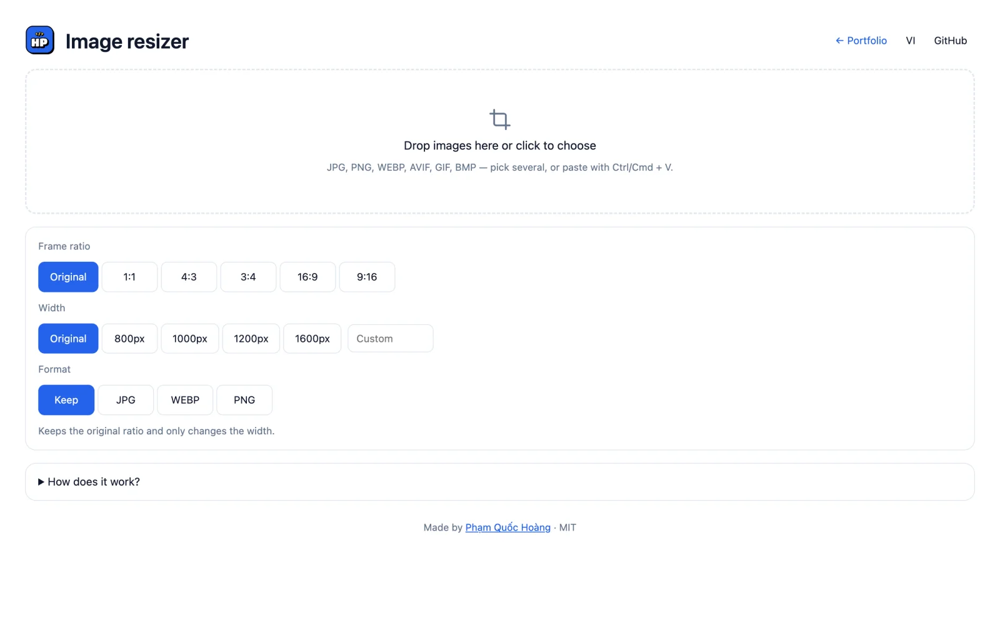

# Image Resizer

Đổi kích thước và cắt ảnh hàng loạt ngay trên trình duyệt — ảnh không được tải lên server nào. Hợp ảnh sản phẩm Shopee, WooCommerce, banner, story.

**Dùng thử:** https://hoangpham.is-a.dev/image-resizer/



## Tính năng

- Nhiều ảnh cùng lúc: kéo thả, chọn file hoặc dán (Ctrl/Cmd + V)
- Tỉ lệ khung: giữ nguyên, **1:1**, **4:3**, **3:4**, **16:9**, **9:16**
  - **Cắt cho vừa khung:** cắt phần thừa quanh tâm ảnh
  - **Giữ trọn ảnh, thêm nền:** không mất chi tiết, phần trống tô trắng
- Chiều rộng: giữ nguyên, 800 / 1000 / 1200 / 1600px hoặc tự nhập — không phóng to ảnh nhỏ
- Định dạng: giữ nguyên, JPG, WEBP, PNG (chất lượng 85%)
- Tên file kèm kích thước mới (ví dụ `ao-thun-1000x1000.jpg`), tải từng ảnh hoặc ZIP
- Giao diện tiếng Việt / English, hỗ trợ dark mode

## Cách hoạt động

Ảnh được vẽ lên `<canvas>` theo kích thước và vùng cắt mới rồi xuất lại bằng `canvas.toBlob()`. ZIP tạo bằng `zip.js` tự viết. Không cần build — chỉ HTML, CSS, JavaScript.

```bash
python3 -m http.server 8000
```

## License

MIT © Phạm Quốc Hoàng
